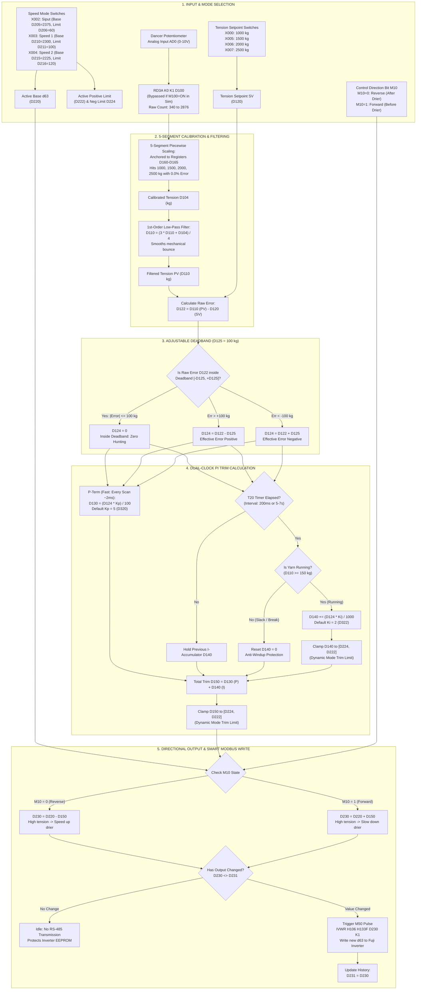
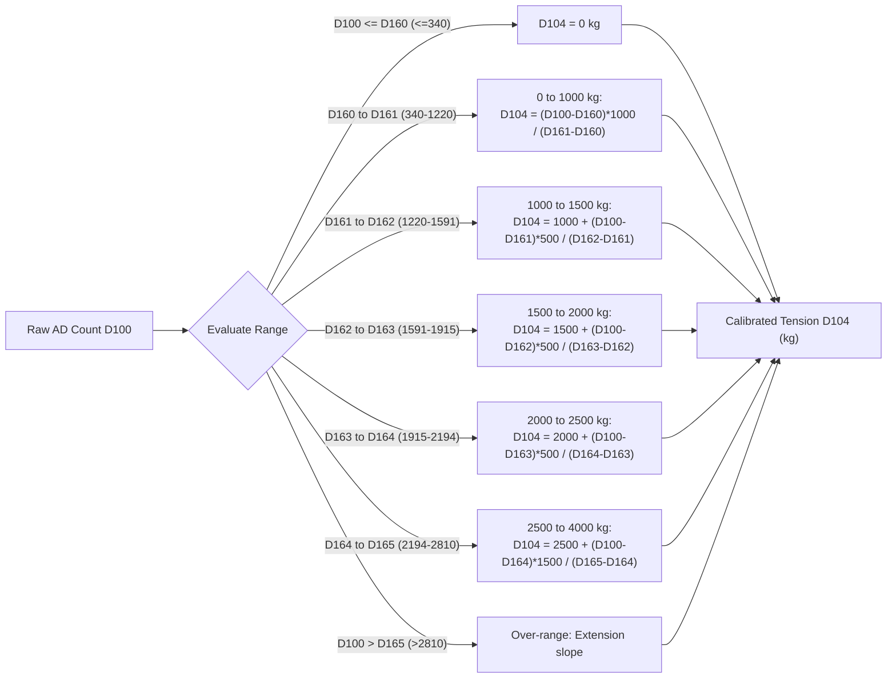
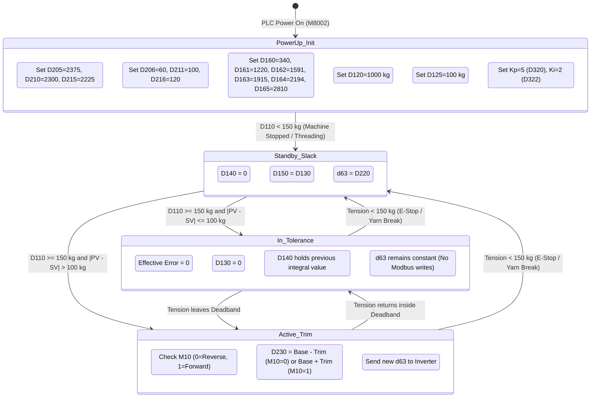

# Working Flow Diagram & Operational Logic Manual
**Textile Sizing Machine (Drier Sizing) – Closed-Loop PI Tension Trim**

- **PLC Hardware**: China Clone FX3U-14MT-6AD-2DA
- **VFD Hardware**: Fuji Electric FRENIC-Mini / Multi / Eco via RS-485 Modbus RTU
- **Target Inverter Parameter**: `d63` (Holding Register `0x133F`, Pulse Scaling Factor 2 / Denominator)
- **Tension Feedback**: Dancer arm potentiometer on Analog Input `AD0` (0–10V / 340 to 2876 counts)
- **Calibration Method**: **5-Segment Piecewise Linear Scaling** (Live-adjustable via registers `D160`–`D165`)
- **Control Direction Bool**: **`M10`** (`0 = Reverse Acting / After Drier`, `1 = Forward Acting / Before Drier`)
- **Reference Code**: [MAIN export.txt](file:///C:/Users/IT/Documents/myProject/drier%20sizing/export/MAIN%20export.txt) and [COMMENT export.txt](file:///C:/Users/IT/Documents/myProject/drier%20sizing/export/COMMENT%20export.txt)

---

## 1. System Overview & Core Physics

The system synchronizes the drying cylinder (*drier*) speed against machine line speed pulses while actively maintaining constant yarn tension via an analog dancer arm.

```
       [Beamer / Pull Rollers]  <--- Pulls yarn downstream
                 ^
                 | (Yarn passes through)
        [DANCER ARM (AD0)]     <--- Reads tension (340 to 2876 counts)
                 ^
                 | (5-7 seconds transport delay)
     [DRYING CYLINDER (DRIER)]  <--- Driven by Fuji Inverter (Parameter d63)
                 ^
                 | Feeds yarn into drying section
            [Size Box]
```

### Governing Equations
1. **Inverter Frequency**:
   $$f^* = N_p \times \frac{d62}{d63}$$
   - **Decreasing `d63`** $\implies$ Drier accelerates (feeds yarn faster).
   - **Increasing `d63`** $\implies$ Drier decelerates (feeds yarn slower).

2. **5-Segment Piecewise Calibration Function**:
   Raw counts from `AD0` (`D100`) are converted into true engineering kilograms (`D104`) through 5 linear segments defined by retentive registers `D160`–`D165`:
   $$D104 = T_i + \frac{(D100 - D16_i) \times \Delta T_i}{D16_{i+1} - D16_i}$$

3. **Forward vs. Reverse Action (`M10`)**:
   $$\text{Final } d63\ (\texttt{D230}) = \begin{cases} \texttt{D220} (\text{Base}) - \texttt{D150} (\text{Trim}) & \text{when } \mathbf{M10 = 0}\ (\textbf{Reverse Acting: After Drier}) \\ \texttt{D220} (\text{Base}) + \texttt{D150} (\text{Trim}) & \text{when } \mathbf{M10 = 1}\ (\textbf{Forward Acting: Before Drier}) \end{cases}$$

---

## 2. Master System Working Flow



---

## 3. Subsystem Detail: 5-Segment Piecewise Calibration

Because the dancer potentiometer has mechanical linkage curvature and a non-zero resting offset, the curve is divided into 5 linear zones. Each boundary is held in a retentive register so it can be fine-tuned anytime without modifying ladder logic:



### Live Calibration Tuning Registers:
- **`D160`** = 0 kg Zero Count (Default: **`340`**)
- **`D161`** = 1000 kg Count (Default: **`1220`**) $\rightarrow$ Aligns with `X000`
- **`D162`** = 1500 kg Count (Default: **`1591`**) $\rightarrow$ Aligns with `X005`
- **`D163`** = 2000 kg Count (Default: **`1915`**) $\rightarrow$ Aligns with `X006`
- **`D164`** = 2500 kg Count (Default: **`2194`**) $\rightarrow$ Aligns with `X007`
- **`D165`** = 4000 kg Count (Default: **`2810`**)

---

## 4. Engineering Guide: Defining the Perfect Base Preset & Trim Limits

In textile sizing machines, dancer arms have a limited physical stroke. If the Base Preset is poorly calibrated, the dancer will hit its top or bottom mechanical stop, saturating the trim. 

The control architecture is designed on the **Feedforward + Trim** principle:
- **Base Preset (`D220`) carries 90%–95% of the synchronization load.**
- **Dancer Trim (`D150`) only compensates for the remaining 5%–10% fine error.**

```
                  [ Ideal Steady State Operation ]
     Base Preset (D220)  ======> Matches nominal line ratio exactly
     PI Trim     (D150)  ======> Floats near 0 (dancer rests in middle)
     Output      (D230)  ======> D220 +/- 0 = D220
```

### The 3-Step Machine Calibration Procedure:

1. **Step 1: Stabilize the Machine in Target Mode**:
   - Engage the desired speed mode (`X002` for Siput, `X003` for Speed 1, or `X004` for Speed 2).
   - Engage the desired tension setpoint (`X000` for 1000 kg, `X005` for 1500 kg, etc.).
   - Let the machine run until yarn speed and moisture reach steady operating temperature.

2. **Step 2: Inspect Register `D150` (Total Dynamic Trim)**:
   - **Scenario A: `D150` floats around `0` (between $-10$ and $+10$)**:
     The Base Preset is **perfect**. The dancer arm is riding naturally in the center of its stroke. No adjustments needed.
   - **Scenario B: `D150` consistently sits at a high positive value (e.g. $+35$ to $+60$)**:
     With default Reverse Action (`M10=0`), the drier is feeding yarn too slowly $\implies$ $d63$ must be lowered.
     - *Correction Formula*:
       $$\text{New Base Preset} = \text{Current Base Register} - D150$$
       *(Example for Speed 1: If `D210 = 2300` and `D150 = +40`, update `D210 = 2300 - 40 = 2260`)*.
   - **Scenario C: `D150` consistently sits at a negative value (e.g. $-35$ to $-60$)**:
     With default Reverse Action (`M10=0`), the drier is feeding yarn too quickly $\implies$ $d63$ must be raised.
     - *Correction Formula*:
       $$\text{New Base Preset} = \text{Current Base Register} + |D150|$$
       *(Example for Speed 1: If `D210 = 2300` and `D150 = -40`, update `D210 = 2300 + 40 = 2340`)*.

3. **Step 3: Lock In & Set Mode Trim Limits (`D206`, `D211`, `D216`)**:
   - Once the Base Preset is dialed in, configure how much dynamic authority the dancer has:
     - **Siput Mode (`D206`, default 60)**: At crawl/threading speeds (5–10 m/min), keep trim tight ($\pm 40$ to $\pm 60$) to avoid jerky cylinder movements.
     - **Speed 1 Mode (`D211`, default 100)**: Standard production speed (30–50 m/min), trim authority $\pm 100$ handles beam diameter changes easily.
     - **Speed 2 Mode (`D216`, default 120)**: High production speed (60–80 m/min), wider trim authority ($\pm 120$ to $\pm 150$) ensures rapid compensation during fast transitions.
   - **Open-Loop Override**: Setting any mode's Trim Limit register to `0` completely disables dancer trim for that mode, locking the cylinder to fixed base speed!

---

## 5. Machine State Transition Diagram



---

## 6. Memory & Register Quick Reference Map

| Address | Type | Name / Function | Normal Value Range |
| :--- | :--- | :--- | :--- |
| **`X000`** | Input | Setpoint 1000 kg Selector Switch | Push / Selector Contact |
| **`X001`** | Input | Spare / Optional Switch | Can be wired to toggle `M10` (Forward/Reverse) |
| **`X002`** | Input | Siput / Crawl Speed Mode Switch | Base $d63 = 2375$ (`D205`), Trim Limit $60$ (`D206`) |
| **`X003`** | Input | Speed 1 Mode Switch | Base $d63 = 2300$ (`D210`), Trim Limit $100$ (`D211`) |
| **`X004`** | Input | Speed 2 Mode Switch | Base $d63 = 2225$ (`D215`), Trim Limit $120$ (`D216`) |
| **`X005`** | Input | Setpoint 1500 kg Selector Switch | Push / Selector Contact |
| **`X006`** | Input | Setpoint 2000 kg Selector Switch | Push / Selector Contact |
| **`X007`** | Input | Setpoint 2500 kg Selector Switch | Push / Selector Contact |
| **`M2`** | Relay | Siput Mode Active Flag | Internal Relay |
| **`M3`** | Relay | Speed 1 Mode Active Flag | Internal Relay |
| **`M4`** | Relay | Speed 2 Mode Active Flag | Internal Relay |
| **`M10`** | **Relay** | **PI Control Direction Selector** | **Boolean: 0 = Reverse (After Drier), 1 = Forward (Before Drier)** |
| **`M50`** | Relay | One-Cycle Pulse to Fire Modbus Write | Triggered when $D230 \ne D231$ |
| **`M100`** | Relay | Simulator Bypass RD3A Bit | Turn ON in Simulator to test D100 |
| **`T20`** | Timer | Integral Calculation Periodic Clock | Default $K2$ ($200\text{ ms}$) |
| **`AD0`** | Analog | Dancer Arm Potentiometer (0–10V) | $340\text{–}2876$ raw counts |
| **`D100`** | Register | Raw Analog Input Counts from `RD3A` | $340\text{–}2876$ |
| **`D102`** | Register | 32-bit Raw Product | Double word (`D102`, `D103`) |
| **`D104`** | Register | **Calibrated Tension (kg)** | True physical tension in kg from 5-segment scaling |
| **`D106`** | Register | Calibration Delta AD Register | Intermediate $\Delta AD$ calculation |
| **`D108`** | Register | Filter Temporary Math Register | $(3 \times D110 + D104)$ intermediate |
| **`D110`** | Register | Filtered Actual Tension ($PV$) | $0\text{–}4250\text{ kg}$ true engineering units |
| **`D120`** | Register | Tension Setpoint ($SV$) | Default $1000\text{ kg}$ |
| **`D122`** | Register | Raw Tension Error ($PV - SV$) | $-4000\text{ to }+4000\text{ kg}$ |
| **`D124`** | Register | Effective Error (Outside Deadband) | $0$ (if inside deadband) |
| **`D125`** | Register | Deadband Range ($\pm$) | Default $100\text{ kg}$ |
| **`D126`** | Register | Negative Deadband ($0 - D125$) | Auto-calculated ($-100\text{ kg}$) |
| **`D130`** | Register | Proportional Trim Term | Scaled by $K_p / 100$ |
| **`D140`** | Register | Integral Trim Accumulator | Clamped $[D224, D222]$ |
| **`D150`** | Register | Total Combined PI Trim ($P + I$) | Clamped $[D224, D222]$ |
| **`D160`** | Register | **CAL AD0 (0 kg)** | **Retentive calibration register: 0 kg raw count (340)** |
| **`D161`** | Register | **CAL AD1 (1000 kg)** | **Retentive calibration register: 1000 kg count (1220)** |
| **`D162`** | Register | **CAL AD2 (1500 kg)** | **Retentive calibration register: 1500 kg count (1591)** |
| **`D163`** | Register | **CAL AD3 (2000 kg)** | **Retentive calibration register: 2000 kg count (1915)** |
| **`D164`** | Register | **CAL AD4 (2500 kg)** | **Retentive calibration register: 2500 kg count (2194)** |
| **`D165`** | Register | **CAL AD5 (4000 kg)** | **Retentive calibration register: 4000 kg count (2810)** |
| **`D168`** | Register | Calibration Span AD Register | Span between adjacent calibration points |
| **`D169`** | Register | 32-bit High Word (0) | Cleared to 0 for DDIV double word division |
| **`D205`** | Register | Siput Base Pulse Factor ($d63$) | Default $2375$ (`0x0947`) |
| **`D206`** | Register | **Siput Max Trim Range** | Default **$60$** ($\pm 60$) |
| **`D210`** | Register | Speed 1 Base Pulse Factor ($d63$) | Default $2300$ (`0x08FC`) |
| **`D211`** | Register | **Speed 1 Max Trim Range** | Default **$100$** ($\pm 100$) |
| **`D215`** | Register | Speed 2 Base Pulse Factor ($d63$) | Default $2225$ (`0x08B1`) |
| **`D216`** | Register | **Speed 2 Max Trim Range** | Default **$120$** ($\pm 120$) |
| **`D220`** | Register | Active Base $d63$ Selection | Matches active mode base register |
| **`D222`** | Register | **Active Positive Trim Limit** | Matches active mode trim limit |
| **`D224`** | Register | **Active Negative Trim Limit** | Auto-calculated ($0 - D222$) |
| **`D230`** | Register | **Final Calculated $d63$ Output** | $D220 - D150$ (`M10=0`) or $D220 + D150$ (`M10=1`) |
| **`D231`** | Register | Last Transmitted $d63$ to Inverter | Change-detection reference |
| **`D320`** | Register | Proportional Gain ($K_p$) | Default $5$ |
| **`D322`** | Register | Integral Gain ($K_i$) | Default $2$ |
